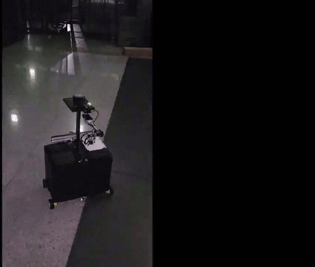
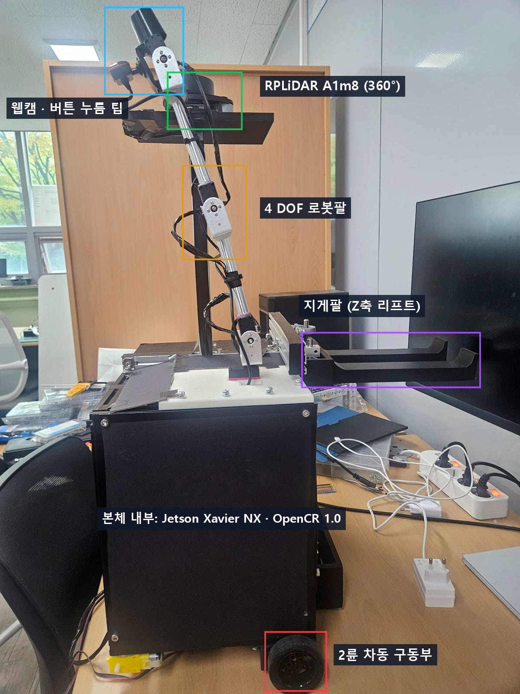
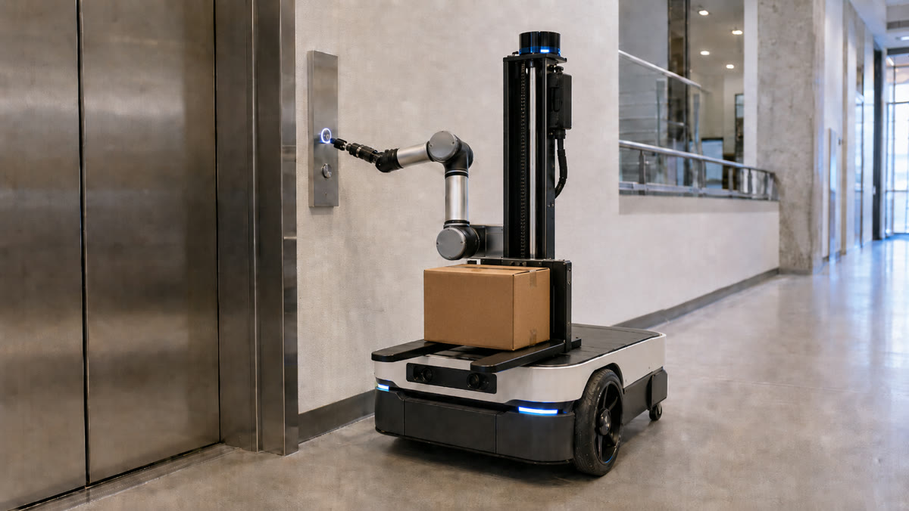
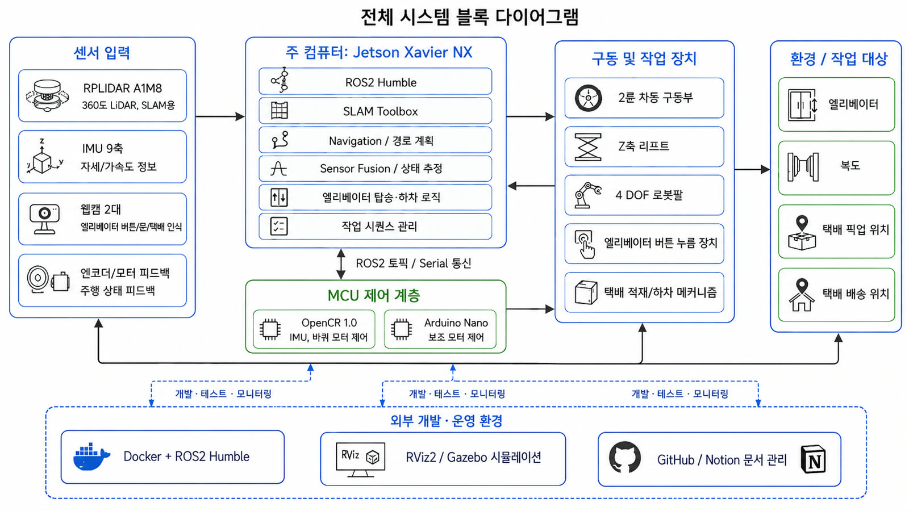
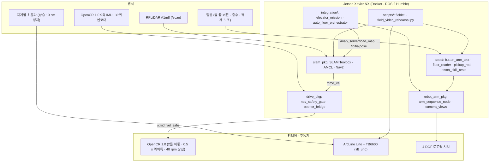
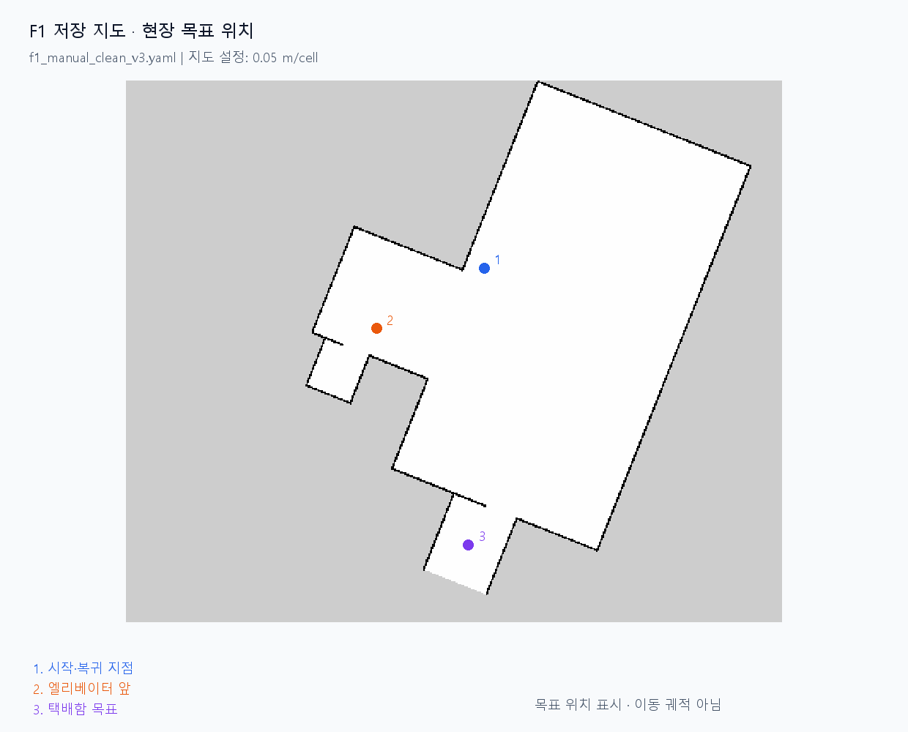
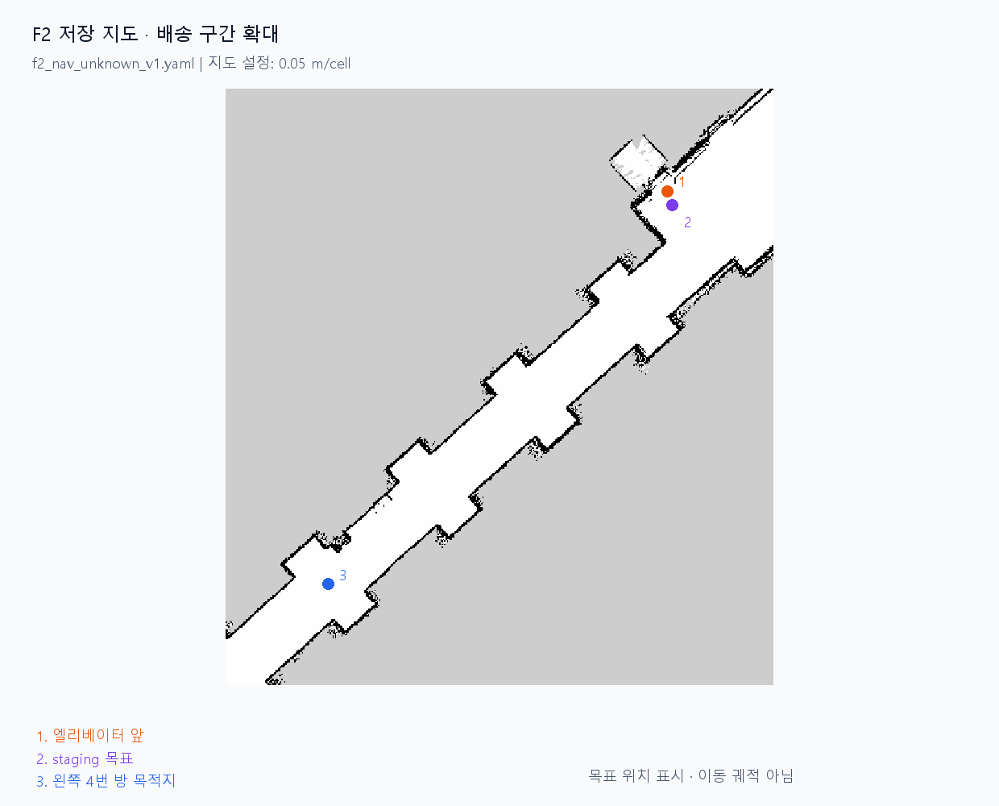
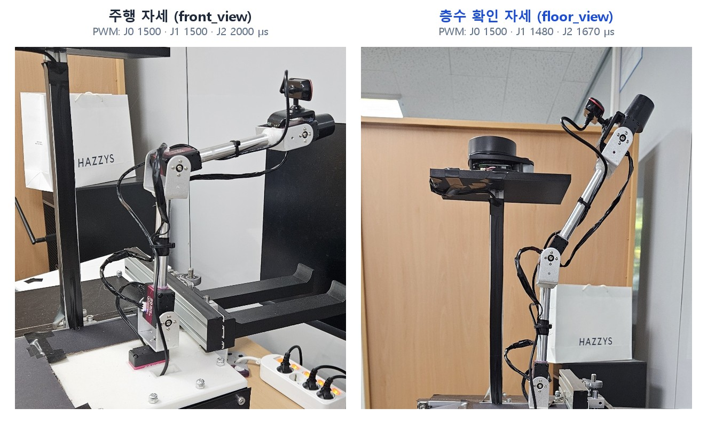
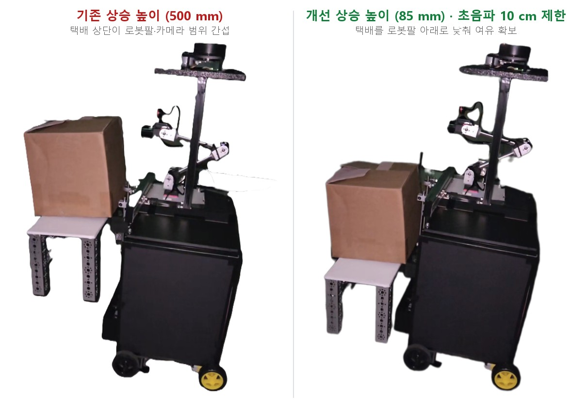

# PackagU

**건물을 고치지 않고 엘리베이터를 타는 실내 택배 배달 로봇**

건국대학교 전기전자공학부 2026 종합설계 5조가 만들었다. 엘리베이터 제조사 API나 제어반 개조 없이 4 DOF 로봇팔이 사람처럼 물리 버튼을 직접 눌러 층을 옮기고 택배를 배달한 뒤 복귀한다.

[왜 만들었는가](#왜-만들었는가) · [전체 동작과 구성](#전체-동작과-구성) · [개발 과정과 일정](#개발-과정과-일정) · [핵심 구현과 개선](#핵심-구현과-개선) · [검증 결과](#검증-결과) · [안전 경계와 한계](#안전-경계와-한계) · [공개 저장소](#공개-저장소) · [팀원](#팀원)

<p align="center">
  
  
</p>
<p align="center"><sub>왼쪽: 신공학관 실물 주행 · 버튼 조작 · 배달 시연 (20초 하이라이트) · 오른쪽: 실물 로봇 주요 부품 (2026-10 촬영)</sub></p>

<p align="center">
  <a href="https://github.com/PackagU/PackagU">
    
  </a>
  <a href="https://github.com/PackagU/PackagU/blob/main/docs/architecture.md">
    
  </a>
  <a href="https://github.com/PackagU/PackagU/blob/main/docs/results.md">
    
  </a>
</p>

---

## 왜 만들었는가

택배는 이미 건물 입구와 경비실까지 온다. 그런데 받는 사람이 다른 층 연구실이나 기숙사에 있으면 **마지막 몇십 미터는 결국 사람이 들고 올라간다.** 국가물류통합정보센터 통계 기준 국내 택배 물동량은 해마다 늘어 건물 내부 반복 운반 부담도 함께 커졌다.

| 연도 | 국내 택배 물동량 (만 박스) | 환산 건수 |
|---|---:|---:|
| 2023 | 515,785 | 약 51.58억 건 |
| 2024 | 595,634 | 약 59.56억 건 |
| 2025 | 641,773 | 약 64.18억 건 |

실외 배송 로봇이 도로와 보도를 푼다면 실내 배송 로봇은 **수직 공간**을 풀어야 한다. 바닥은 평탄하지만 엘리베이터라는 공유 설비를 거쳐야 하고 버튼은 사람 손 기준으로 만들어져 있다.

엘리베이터를 쓰는 접근은 크게 세 가지다.

| 방식 | 장점 | 한계 | 채택 |
|---|---|---|---|
| 엘리베이터 API · 관제 연동 | 호출 성공률 높음, 운행 정보 직접 수신 | 제조사 협조와 건물 관리자 승인 필수, 승인된 건물에만 적용 | 향후 확장안 |
| 패널 부착형 누름 모듈 | 제어기 개조 없음, 반복성 높음 | 층마다 별도 설치와 현장 허가 필요 | 참고 방식 |
| **로봇팔 직접 버튼 조작** | **건물 설비 개조 없음, 일반 건물 적용 가능** | 카메라 인식 · 정렬 · 팔 제어 난도 높음 | **기본 구현안** |

**"건물 승인이나 개조 없이 그대로 굴릴 수 없을까?"** 이 질문에서 버튼을 직접 누르는 방식을 택했다. 선행 연구(Wu 등, 2023)에서 AMR과 eye-in-hand 로봇팔의 버튼 누름 평균 성공률은 약 60%로 보고된다. 병목은 팔의 힘보다 버튼 인식과 정렬 정확도다. 그래서 주행부로 버튼 앞까지 먼저 정렬하고 짧은 거리에서 웹캠과 4 DOF 팔로 조작하는 구조로 잡았다.

---

## 전체 동작과 구성

초기 외형 설계에서 하단 2륜 차동 구동부, 전면 Z축 지게팔 적재부, 상단 4 DOF 로봇팔과 RPLiDAR 마스트로 역할을 나누었다.

<p align="center">
  
</p>
<p align="center"><sub>초기 외형 예상도 (하단 2륜 차동 구동부 · 전면 Z축 지게팔 · 상단 4 DOF 팔과 LiDAR)</sub></p>

<p align="center">
  
</p>
<p align="center"><sub>호출 수신부터 복귀까지 전체 시나리오 흐름 (초기 설계 그림)</sub></p>

### 배송 시나리오 (10단계)

1. 1층 출발 위치에서 배송 미션을 시작한다.
2. Nav2로 택배 보관함 앞까지 주행해 팔레트에 정렬한다.
3. Z축 지게팔(`lift_uno`)로 택배를 들어 올린다. 정면 초음파 센서가 상승 중 10 cm 미만이면 즉시 멈춰 로봇팔 간섭을 막는다.
4. 1층 엘리베이터 승강장으로 이동해 호출 버튼 앞에 선다.
5. 팔 끝 웹캠으로 호출 버튼(▲)을 인식하고 4 DOF 로봇팔로 누른다.
6. 문이 열리면 엘리베이터 내부로 진입해 목표 층 버튼(4층)을 인식해 누른다.
7. 탑승 직후 로봇팔을 층수 확인 자세(`floor_view`)로 올려 웹캠으로 층수 표시기를 읽는다.
8. 목표층 도착과 문 열림을 확인한 뒤 하차한다. 이어서 `/map_server/load_map`과 `/initialpose`로 목적층 지도로 전환한다.
9. 목적층 배달 지점까지 Nav2로 주행해 지게팔을 내려 택배를 놓는다.
10. 같은 절차로 1층으로 복귀한다. 어느 단계든 안전 조건이 깨지면 진행을 멈추고 정지한다.

### 소프트웨어 · 하드웨어 아키텍처



SLAM 모드와 Nav2 모드를 분리해 운영한다. 먼저 SLAM Toolbox로 층별 지도를 저장한다. 주행 시에는 SLAM을 끈 상태에서 `map_server + AMCL + Nav2`로 저장 지도 위를 달린다.

---

## 개발 과정과 일정

2026년 3월 기획부터 11월 최종 발표·피드백 반영까지 9개월간 시뮬레이션 검증 → 실물 제작 · 브링업 → 실측 지도 통합 → 현장 시연 순서로 밟았다.


| 시기 | 주요 작업 | 핵심 결과 · 산출물 |
|---|---|---|
| **2026-03 ~ 05** | 종합설계 5조 기획, 문턱 통과 토크 산정, Fusion 360 섀시 · 지게팔 기구 설계. ROS 2 Humble Docker 환경과 기본 패키지 4개(`common_pkg`, `slam_pkg`, `drive_pkg`, `robot_arm_pkg`) 구축 | `delivery_robot.urdf.xacro`, 가상 건물(KKU) F1~F3 월드 |
| **2026-05 ~ 06** | `integration/` overlay 3종 구현. 텔레포트 방식(A안)의 `/scan` 불일치 문제를 확인하고 Gazebo 건물 모델 교체 + `/map_server/load_map` + AMCL 재정위 방식으로 전환 | 06-25 · 06-29 층 전환 스모크 통과(`F1 → F2` 엔티티 · `/scan` 확인) |
| **2026-07** | 하드웨어 단일 기준 문서(`hardware_spec.md`) 작성. 개발 PC(amd64)와 Jetson(aarch64) Dockerfile 분리 및 호스트 종속 검사기(`check_portability.py`) 도입 | `docker/Dockerfile.jetson`, `scripts/check_portability.py` |
| **2026-08** | 바퀴 마찰 · 볼캐스터 모델 수정으로 정지 드리프트 해소(0.0000 m / 90 s). 데스크톱 Gazebo 왕복 반복 시험과 PC Gazebo + Jetson 분산 부하 시험 수행 | 08-21 가상 왕복 10/10 연속 통과, Jetson 분산 E2E 3/3 통과(RAM 피크 2.5 / 6.8 GB) |
| **2026-09** | 실기 구동부 제작 완료, OpenCR 시리얼 브리지와 `nav_safety_gate` 정비. 신공학관 F1 · F2 실측 지도 작성, 복도 Nav2 주행 시험, 4 DOF 로봇팔 · 웹캠 버튼 인식(`button_arm_test`) 시험 | 09-10 LiDAR `/scan`, 09-12 실측 맵 저장, 09-16 신공학관 복도 Nav2 2/5 도착 |
| **2026-10** | 신공학관 실측 지도 Gazebo E2E 시뮬(V5), 현장 · 시뮬 공용 자율 상태머신(`apps/jetson_skill_tests/`), 2면 ArUco 자동 팔레트 집기(`apps/pickup_real/`), 26단계 E2E 진행기(`field_video_rehearsal.py`)와 `lift_uno` 초음파 높이 제한 펌웨어 반영 | 10-08 실측 지도 E2E direct 4/4 · AMCL 12/12, 10-29 자동 집기 18/18 · `lift_uno` 보드 플래시 대조 일치 |
| **2026-11** | 강의실 v3 배치도 시뮬레이션 4,112회 반복 검증, 최종 발표 및 피드백 개선안(적재 높이 500 mm → 85 mm 축소 · 로봇팔 `floor_view` 층수 확인 자세) 정리, 보고서용 공개 저장소 `PackagU/PackagU` 게시 | 11-04 강의실 v3(짐 폭 가림 경계 31~32 cm), 11-19 공개 저장소 정적 감사 FAIL 0 |

<p align="center">
  
  
</p>
<p align="center"><sub>2026-09 신공학관 현장에서 RPLiDAR A1m8 + SLAM Toolbox로 작성한 실측 지도 (왼쪽: 1층 F1 · 오른쪽: 상위층 F2 지도)</sub></p>

---

## 핵심 구현과 개선

### 1. 층별 지도 자동 전환과 잔존 지도 차단

2D SLAM 지도는 한 층 단위로만 만든다. 층을 옮긴 직후 `/map_server/load_map`과 `/initialpose`만 호출하면 이전 층 costmap이 잠시 남아 경로가 꼬이거나 `/scan`과 맵이 어긋나 AMCL이 발산한다. 현장 진행기(`scripts/field_video/ros_map_switch.py`)와 오케스트레이터(`integration/elevator_auto_map_switch/`)는 새 지도의 크기·원점·해상도와 global costmap 벽 칸 일치 여부를 확인한 뒤에만 다음 Nav2 goal을 보낸다.

<details>
<summary>층 전환 · 미션 overlay 구조 펼쳐 보기</summary>

- **floor_map_registry (`integration/elevator_auto_map_switch/`)**: `floor_maps.yaml`에서 층 번호를 지도 경로와 엘리베이터 출입 초기 자세로 매핑한다.
- **auto_floor_orchestrator_pkg**: `/elevator/state` 이벤트를 받아 `map_server` 재로드와 `/initialpose` 주입을 순서대로 처리한다.
- **gazebo_world_swap_pkg (`integration/gazebo_world_swap/`)**: 시뮬레이션에서 로봇 텔레포트(A안) 대신 Gazebo 건물 모델 자체를 교체(`F1 ↔ F2`)해 `/scan`과 지도를 일치시킨다.
- **elevator_mission_pkg (`integration/elevator_mission/`)**: `delivery_missions.yaml` 기반 행동 트리, `kku_nav_points.yaml` 좌표 레지스트리, 복도 벽 스침을 줄이는 직교 경로 라우터(`orthogonal_router`)를 묶었다.
- 루트 실기 패키지 4개(`src/`)와 overlay 3개(`integration/`)는 `integration/COLCON_IGNORE`로 분리해 루트 빌드 시 ament index 충돌을 막았다.

</details>

### 2. 버튼 직접 조작과 층수 확인 후 하차 (피드백 개선)

승강기마다 버튼 높이와 간격이 다르다. 팔 끝 웹캠으로 버튼판과 점등 램프를 보고 웹 서버/API(`apps/button_arm_test/`)가 인식 안정을 확인한 뒤 티칭된 PWM 시퀀스(`servo_protocol.py`)로 누른다.

시연 피드백에서 **문 열림만 보고 내리면 중간층 정차 시 오하차할 수 있다**는 지적을 받아 층수 확인 단계를 보완했다. 엘리베이터 탑승 직후 로봇팔을 주행 자세(`front_view`)에서 층수 확인 자세(`floor_view`)로 올린다. 팔 끝 웹캠으로 층수 표시기를 읽고(`apps/floor_reader/`) 목표층과 일치할 때만 하차 조건을 연다.

<p align="center">
  
</p>
<p align="center">
  
</p>
<p align="center"><sub>위: 로봇팔 자세 전환 실물 비교 (`camera_views.json` PWM µs 기준) · 아래: `floor_reader` 4층 인식 화면 (일치 점수 0.79)</sub></p>

<details>
<summary>로봇팔 자세 PWM · 층수 인식 판정 기준 펼쳐 보기</summary>

- **자세 설정 (`src/robot_arm_pkg/config/camera_views.json`)**:
  - 주행 자세 `front_view`: `J0=1500, J1=1500, J2=2000, J3=1500 µs` (`duration_ms=2000`)
  - 층수 확인 자세 `floor_view`: `J0=1500, J1=1480, J2=1670, J3=1500 µs`
- **층수 인식 (`apps/floor_reader/app.py`)**: 지정 ROI를 Otsu 이진화한 뒤 비율을 유지해 `96×160`으로 정규화한다. 이어서 7-segment 숫자 템플릿과 IoU 매칭(`score >= 0.70`, 2위와 마진 `>= 0.08`)으로 판정한다.
- **오인식 방지 게이트**: `app.py`는 1.5 s 창 내 최근 10프레임 중 8프레임 이상 일치할 때 `TARGET_FLOOR_DETECTED`를 낸다. 하차 판정기(`scripts/floor_arrival_probe.py`)는 현재 영상 5회 연속 일치를 확인한다.

</details>

### 3. 2륜 차동 구동부, 안전 게이트, Z축 지게팔 높이 제한 (피드백 개선)

Nav2가 내는 `/cmd_vel`은 `nav_safety_gate`를 거친다. `/scan`이나 `/odom`이 끊기면 `/cmd_vel_safe`를 즉시 0으로 자른다. OpenCR 1.0 펌웨어에서도 0.5 s 호스트 명령 타임아웃과 48 rpm 속도 상한을 별도로 걸었다.

시연 피드백에서 **지게팔을 끝까지 올리면 택배 상단이 로봇팔과 웹캠 시야를 가린다**는 문제가 제기되었다. 정면 초음파 센서(`firmware/lift_uno/lift_uno.ino`)가 상승 중 320펄스(약 100 ms)마다 거리를 확인해 10 cm 미만이면 즉시 멈추게 했다. 지게팔 상승 높이도 기존 500 mm에서 85 mm 수준으로 줄여 로봇팔 아래 여유를 확보하는 개선안을 마련했다.

<p align="center">
  
</p>
<p align="center"><sub>지게팔 상승 높이 조정 전후 실물 비교 (왼쪽: 기존 500 mm · 오른쪽: 개선 85 mm + 초음파 10 cm 정지)</sub></p>

<details>
<summary>구동부 문턱 토크 산정 · 지게팔 펌웨어 상세 펼쳐 보기</summary>

- **문턱 통과 정적 토크 근사**: 총 하중 20 kg, 바퀴 반지름 35 mm, 엘리베이터 문턱 높이 10 mm 기준으로 접촉 모서리 수평 거리 `d ≈ 0.0245 m`, 바퀴당 정적 요구 토크 `T_static ≈ 2.4 N·m`를 산정해 2배 이상 여유를 목표 기준으로 잡았다.
- **실물 기구 치수 (`docs/hardware_spec.md`)**: 바퀴 간격 `0.51324 m`, 바퀴 지름 `0.066 m`, 섀시 `0.3 × 0.4 × 0.25 m`, LiDAR 장착 높이 `0.750 m`.
- **지게팔 펌웨어 (`firmware/lift_uno/lift_uno.ino`)**: Arduino Uno + TB6600(PUL D7, DIR D6, ENA D5, 초음파 TRIG D9 / ECHO D10). `u`/`d` 1회 최대 12,800펄스(HIGH 10 µs / LOW 302 µs), 상승 중 320펄스마다 초음파 확인 후 10 cm 미만 정지.

</details>

### 4. PC(amd64) · Jetson(aarch64) 이중 컨테이너와 공용 상태머신

Jetson Xavier NX의 JetPack(Ubuntu 20.04)은 ROS 2 Humble을 호스트에서 직접 지원하지 않는다. 개발 PC(amd64)와 Jetson(aarch64) 아키텍처 차이 때문에 처음부터 `docker/Dockerfile`(Gazebo · RViz 포함)과 `docker/Dockerfile.jetson`(런타임 전용)으로 나누었다. Nav2 구간 사이의 미세 동작 상태머신(`apps/jetson_skill_tests/skilltests/`)은 실기와 시뮬레이션이 같은 코드를 공유하고 입출력 어댑터(`ros_adapters.py` ↔ `sim_adapters.py`)만 교체한다.

---

## 검증 결과

실물 시험, 시뮬레이션, 오프라인 정적 검사를 구분해 적는다. 세부 조건과 로그 근거는 [`PackagU/docs/results.md`](https://github.com/PackagU/PackagU/blob/main/docs/results.md)에 정리했다.

| 구분 | 대상 | 환경 · 날짜 | 결과 | 판정 | 비고 · 한계 |
|---|---|---|---|---|---|
| **실물** | 신공학관 배달 시연 | 건물 복도 · 엘리베이터 실물 | 20초 편집본에서 적재 → 호출 버튼 인식 · 누르기 → 탑승 · 4번 버튼 → 목적층 하차 · 배달 확인 | 실물 검증 (하이라이트) | 상단 `e2e_demo.gif`. 자율/수동 경계와 복귀 구간은 영상만으로 미확인 |
| **실물** | 신공학관 복도 Nav2 주행 | Jetson + RPLiDAR + OpenCR, F1 · F2 (2026-09-16) | 5회 중 2회 도착(F2 배달 244.1 s, F1 복귀 119.2 s), 3회 실패 | 실물 검증 (부분 성공) | 보관함과 F2 staging goal 실패 |
| **실물** | 지게팔 `lift_uno` 보드 대조 | Jetson 연결 Arduino Uno (2026-10-29) | 플래시 덤프와 소스 일치(10/302 µs, 12,800펄스, 초음파 10 cm 정지) | 실물 검증 (보드 대조) | 진행기 연동 주행은 미실행 |
| **단품** | 층수 표시기 인식 (`floor_reader`) | 웹캠 + 테스트 화면 | 목표 4층 이진화 · 템플릿 매칭 일치 점수 `0.79` | 오프라인 · 단품 확인 | 승강기 내부 실물 연속 하차 미검증 |
| **시뮬** | 가상 건물 왕복 · 분산 부하 | Gazebo + 보행자 5 + 장애물 2 (2026-08-21) | PC 10/10 통과(드리프트 0.0000 m / 90 s), Jetson 분산 3/3 통과(RAM 피크 2.5 / 6.8 GB) | 시뮬레이션 검증 | 가상 치수 맵 기준 |
| **시뮬** | 신공학관 실측 지도 E2E (V5) | 격리 Gazebo + 인코더 odom (2026-10-08) | 사전시험 19/19, 캐빈 direct 4/4 완주, nav2 1/3, AMCL 재정위 12/12 수렴(4.3~8.4 s, 오차 0.029~0.090 m) | 시뮬레이션 검증 | 좁은 문 벽 여유 0.069~0.082 m(기준 0.15 m 미달) |
| **시뮬** | 독립 자동 택배 집기 | 격리 Gazebo + ArUco 지그 (2026-10-29) | 4개 스위트 18/18 통과 | 시뮬레이션 검증 | 기하 판정 attach 기준, 접촉 · 하중 물리 미검증 |
| **시뮬** | 강의실 v3 배치도 반복 | 격리 Gazebo + 레이캐스트 4,112회 (2026-11-04) | 일반 12/12, 적재 거친 조건 7/9, 짐 폭 라이다 가림 경계 31~32 cm, 고정 복귀 제안 300/300 | 시뮬레이션 검증 | 실물 접촉 미검증 |
| **오프라인** | 공개 저장소 정적 검사 | 호스트 Python 3.12 (2026-11-19) | `.py` 264개 `py_compile` 오류 0, 커밋 트리 · 이력 감사 FAIL 0 | 오프라인 검증 | Docker 테스트와 `colcon build` 미실행 |

---

## 안전 경계와 남은 한계

PackagU는 연구 · 종합설계 프로토타입이며 사람이 오가는 공간에서 무감독 운용할 수 없다.

- **물리 접촉 · 하중 한계**: 시뮬레이션은 로봇팔 접촉력, 화물 마찰, 실제 엘리베이터 문 열림 시간(5~10 s)을 그대로 모사하지 못했다.
- **지게팔 위치 센서 부재**: `lift_uno`에는 리밋 스위치와 절대 위치 센서가 없다. 12,800펄스 이동과 상승 중 초음파 10 cm 정지만 수행하므로 통신 단절 시 포크 높이를 운영자가 눈으로 확인해야 한다.
- **버튼 접촉 판정 한계**: 팔 누르기 명령 완료는 물리 접촉을 증명하지 못한다. 실제 눌림 여부는 버튼 램프 점등과 운영자 확인에 의존한다.
- **엘리베이터 내부 센서 조건**: 스테인리스 벽 반사·조명 변화 조건에서 `floor_reader` 연속 하차 연동과 문 열림 자동 감지는 추가 실물 검증이 필요하다.
- **적재물 LiDAR 가림**: 화물이 LiDAR 스캔면(0.67~0.75 m) 위로 올라오면 전방 스캔이 가려진다. 강의실 v3 시뮬레이션에서는 짐 폭 32 cm 이상에서 적재 벽 맞춤이 멈췄다.

---

## 공개 저장소

모든 공개 코드와 문서는 [**PackagU/PackagU**](https://github.com/PackagU/PackagU) 한 곳에 모아 정리했다.

```text
PackagU/
├─ src/                        ROS 2 루트 패키지 4개 (common_pkg · slam_pkg · drive_pkg · robot_arm_pkg)
├─ integration/                루트와 분리 빌드하는 overlay 3종 (COLCON_IGNORE 포함)
│  ├─ elevator_mission/        배송 미션 행동 트리 · 직교 경로 라우터 · 안전 FSM
│  ├─ elevator_auto_map_switch/ 층별 지도 레지스트리 · map_server 교체 · AMCL 재정위
│  └─ gazebo_world_swap/       시뮬레이션 전용 Gazebo 건물 월드 교체 · 보행자 장애물
├─ apps/                       버튼 인식 웹/API · 층수 판독(floor_reader) · 팔레트 집기 · 공용 상태머신
├─ firmware/                   OpenCR 1.0 구동/IMU 스케치 · Arduino Uno 지게팔(lift_uno) 펌웨어
├─ scripts/                    현장 CLI(fieldctl) · 26단계 E2E 진행기 · 이식성/계약 테스트 51종
├─ sim/real_maps/              신공학관 실측 지도 Gazebo 시뮬레이션 코드와 결과 요약 (열람용)
├─ docker/                     개발 PC(amd64) · Jetson(aarch64) Dockerfile과 Compose 설정
└─ docs/                       시스템 구성 · 하드웨어 사양 · 검증 결과 · 개발 타임라인 · 현장 배포 문서
```

- [프로젝트 README](https://github.com/PackagU/PackagU/blob/main/README.md) · [시스템 구성 (`docs/architecture.md`)](https://github.com/PackagU/PackagU/blob/main/docs/architecture.md) · [하드웨어 사양 (`docs/hardware_spec.md`)](https://github.com/PackagU/PackagU/blob/main/docs/hardware_spec.md)
- [검증 결과와 한계 (`docs/results.md`)](https://github.com/PackagU/PackagU/blob/main/docs/results.md) · [개발 타임라인 (`docs/development_log.md`)](https://github.com/PackagU/PackagU/blob/main/docs/development_log.md) · [빌드 및 실행 참고 (`docs/how_to_run.md`)](https://github.com/PackagU/PackagU/blob/main/docs/how_to_run.md)

---

## 기술 스택


<details>
<summary>참고 문헌 · 제3자 라이선스 펼쳐 보기</summary>

**주요 참고 자료**
- 국가물류통합정보센터, 월별 생활물류(택배) 통계 (2023~2025)
- Troniak 등 (2013), *Charlie rides the elevator: Integrating vision, navigation and manipulation towards multi-floor robot locomotion*, CRV 2013
- Wu 등 (2023), *Hybrid Navigation of an Autonomous Mobile Robot to Depress an Elevator Button*, JAMRIS 16(4)
- Kim 등 (2024), *Development of an Indoor Delivery Mobile Robot for a Multi-Floor Environment*, IEEE Access 12
- Park 등 (2024), *Efficient Route Planning and Elevator Inter-floor Movement System for a Multi-floor, Multi Delivery Robot*, IEIE 61(8)

**주요 오픈소스 라이선스**
- PackagU 공개 코드: [MIT License](https://github.com/PackagU/PackagU/blob/main/LICENSE)
- ROS 2 Humble · Navigation2 (Nav2) · Gazebo Classic · DYNAMIXEL SDK: Apache-2.0
- SLAM Toolbox: LGPL-2.1 · `rplidar_ros`: BSD-3-Clause

</details>

---

## 팀원

건국대학교 전기전자공학부 2026 종합설계 5조

| 이름 | GitHub | 담당 영역 |
|---|---|---|
| **이준형** | [@JunhyungLee25](https://github.com/JunhyungLee25) | SLAM, Nav2, 층별 자동 지도 전환, Gazebo 시뮬레이션, 현장 통합 |
| **한수민** | [@inonewater](https://github.com/inonewater) | Fusion 360 기구 설계, 2륜 차동 구동부, Z축 지게팔(리프트) |
| **이성덕** | [@DuckFrog123](https://github.com/DuckFrog123) | 4 DOF 로봇팔, 엘리베이터 버튼 · 층수 인식 및 조작 제어 |
